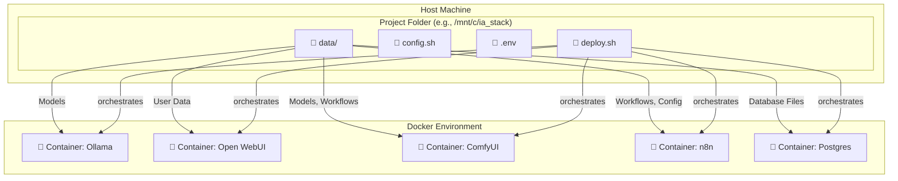

---

# Unified AI Stack

[](https://shields.io/)
[](https://shields.io/)
[](https://opensource.org/licenses/MIT)

Ce projet fournit une solution complète et en un clic pour déployer un environnement local puissant pour l'intelligence artificielle et l'automatisation. Il intègre et configure automatiquement les services suivants :

*   🧠 **Ollama** : Pour servir des grands modèles de langage (LLM) en local.
*   💬 **Open WebUI** : Une interface utilisateur conviviale pour interagir avec les modèles Ollama.
*   🎨 **ComfyUI** : Un système d'interface nodale puissant pour la génération d'images et de vidéos.
*   🤖 **n8n** : Une plateforme d'automatisation de workflows "fair-code".
*   🐘 **PostgreSQL** : Une base de données robuste pour n8n.

## ✨ Fonctionnalités Clés

*   🚀 **Déploiement en Un Clic** : Un unique script `deploy.sh` vérifie votre système, configure et lance toute la stack.
*   📦 **Persistance des Données Garantie** : Sépare le code de l'application (jetable) de vos données (modèles, configurations, workflows), qui sont stockées en toute sécurité sur votre machine.
*   🔧 **Hautement Configurable** : Personnalisez facilement les ports, les chemins, et les listes de modèles/plugins via un fichier de configuration simple.
*   🔒 **Sécurisé par Conception** : Isole les informations sensibles comme les mots de passe dans un fichier `.env` qui n'est pas partagé.
*   ✅ **Robuste et Intelligent** : Le script de déploiement vérifie les dépendances, l'accès au GPU et l'espace disque avant de commencer.
*   🖥️ **Multi-plateforme** : Instructions claires pour les utilisateurs Windows (via WSL2), Linux et macOS.

## 🏗️ Architecture

Le principe fondamental est la séparation des conteneurs (l'application) des volumes (les données). Toutes vos données précieuses résident dans un dossier `data/` sur votre machine, tandis que les conteneurs Docker restent légers et interchangeables.



## 📋 Pré-requis

Avant de commencer, assurez-vous que votre système est prêt.

| Logiciel                    | Windows (via WSL2)                                                              | Linux (Debian/Ubuntu)                               |
| --------------------------- | ------------------------------------------------------------------------------- | --------------------------------------------------- |
| **GPU & Pilotes**           | Drivers NVIDIA installés                                                        | Drivers NVIDIA installés                            |
| **Docker**                  | [Docker Desktop](https://www.docker.com/products/docker-desktop/) (avec WSL2)     | [Docker Engine](https://docs.docker.com/engine/install/ubuntu/) & Compose Plugin |
| **Accès GPU pour Docker**   | Géré automatiquement par Docker Desktop                                         | [NVIDIA Container Toolkit](https://docs.nvidia.com/datacenter/cloud-native/container-toolkit/latest/install-guide.html) |
| **Git**                     | [Git for Windows](https://git-scm.com/download/win)                             | `sudo apt install git`                              |
| **aria2**                   | `sudo apt install aria2` (dans le terminal WSL)                                 | `sudo apt install aria2`                            |

## 🚀 Démarrage Rapide

Suivez ces étapes pour avoir une stack fonctionnelle en quelques minutes.

### 1. Préparation du Projet

Créez un dossier pour votre projet et placez-y les 3 fichiers suivants :
*   `deploy.sh` (le script principal)
*   `config.sh` (la configuration)
*   `.env` (les secrets)

### 2. Configuration de l'Environnement

⚠️ **C'est l'étape la plus importante.**

1.  **Ouvrez `config.sh`** :
    *   Modifiez la variable `BASE_DIR` pour qu'elle pointe vers un **chemin absolu** sur votre machine.
        *   **Exemple WSL :** `export BASE_DIR="/mnt/c/Users/MonNom/projets/ia_stack"`
        *   **Exemple Linux :** `export BASE_DIR="/home/mon_nom/projets/ia_stack"`
    *   Vous pouvez aussi y changer les ports des services si les valeurs par défaut sont déjà prises.

2.  **Ouvrez `.env`** :
    *   Changez la valeur de `POSTGRES_PASSWORD` pour un mot de passe fort et unique.

### 3. Lancement du Déploiement

Ouvrez un terminal (WSL ou Bash sur Linux), naviguez jusqu'au dossier de votre projet, et lancez les commandes suivantes :

```bash
# 1. Naviguez vers le dossier de votre projet
# cd /mnt/c/Users/MonNom/projets/ia_stack

# 2. Rendez le script exécutable (une seule fois)
chmod +x deploy.sh

# 3. Lancez le déploiement !
./deploy.sh
```

Le script va maintenant vérifier votre système, vous demander une confirmation, puis construire, télécharger et lancer tous les services. Soyez patient, cela peut prendre un certain temps.

## 💻 Accès et Gestion

Une fois le déploiement terminé, vous pouvez accéder à vos services :

| Service      | URL                                |
| :----------- | :--------------------------------- |
| **Open WebUI** | `http://localhost:8080`            |
| **ComfyUI**    | `http://localhost:8188`            |
| **n8n**        | `http://localhost:5678`            |

### Commandes de Gestion Quotidienne

Pour gérer la stack, placez-vous dans le dossier `BASE_DIR` et utilisez les commandes `docker compose` :

| Action                       | Commande                    |
| :--------------------------- | :-------------------------- |
| **Arrêter tous les services**  | `docker compose down`         |
| **Démarrer tous les services** | `docker compose up -d`        |
| **Redémarrer la stack**      | `docker compose restart`      |
| **Voir les logs en direct**  | `docker compose logs -f nom-du-service` |

## 🧩 Étendre la Stack

### Ajouter un Modèle Ollama

Exécutez cette commande dans votre terminal :
```bash
docker exec -it ollama ollama pull nom-du-modele:tag
```

### Ajouter un Plugin ComfyUI

1.  Ouvrez le fichier `config.sh`.
2.  Ajoutez l'URL du dépôt Git du plugin à la liste `COMFYUI_PLUGINS`.
3.  Lancez à nouveau le script `./deploy.sh`. Il ne reconstruira rien, mais il détectera et téléchargera le nouveau plugin.

## 📁 Structure du Projet Détaillée

*   `🚀 deploy.sh`: Le script d'orchestration principal. Il est idempotent et sûr à ré-exécuter.
*   `⚙️ config.sh`: Fichier de configuration central pour les chemins, ports, et listes d'assets. C'est le seul fichier que vous devriez modifier pour la personnalisation.
*   `🔒 .env`: Stocke les informations sensibles (mots de passe, clés API). **Doit être ignoré par Git.**
*   `📄 .gitignore`: Assure que les secrets (`.env`) et les données volumineuses (`data/`) ne sont pas envoyés sur Git.
*   `📂 data/`: Un dossier créé par le script pour stocker **toutes** les données persistantes, triées par service.
