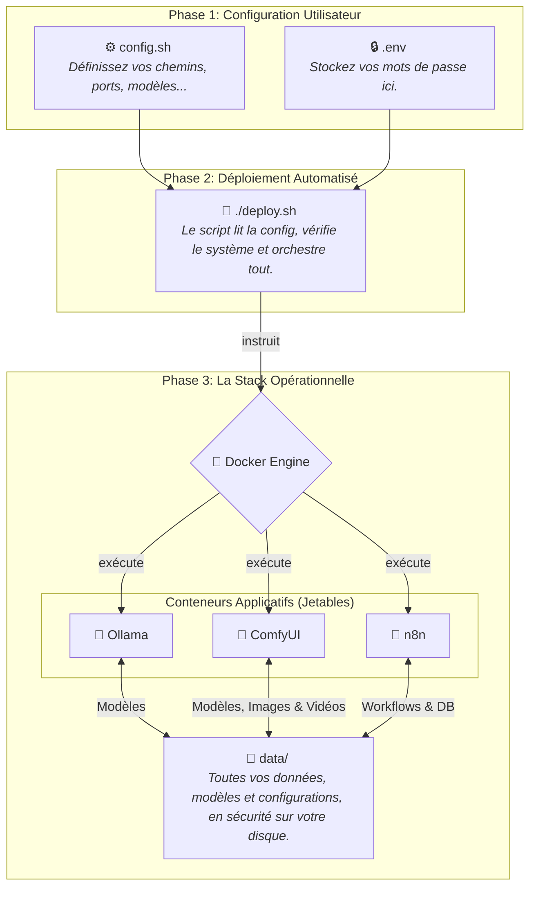

# 🚀 Unified AI Stack Framework

[](https://shields.io/)
[](https://shields.io/)
[](https://opensource.org/licenses/MIT)

Transformez votre machine locale en un puissant studio de création et de production IA. La **Unified AI Stack** est un framework de déploiement qui unifie la **génération de langage, d'images et de vidéos** avec l'automatisation de workflows. Il est conçu pour les développeurs, les artistes et les créateurs qui souhaitent prototyper et construire des applications d'IA complexes avec une infrastructure locale, sécurisée et performante.

Ce projet automatise l'installation, la configuration et l'interconnexion de :

*   🧠 **Ollama** | 💬 **Open WebUI** : Pour l'expérimentation et le service de LLMs.
*   🎨 **ComfyUI** : Pour la génération nodale avancée **d'images et de vidéos**.
*   🤖 **n8n** & 🐘 **PostgreSQL** : Pour l'automatisation de workflows complexes.

## ✨ Les Possibilités : Que Pouvez-vous Construire ?

En intégrant ces outils, vous débloquez des cas d'usage avancés qui combinent texte, image et vidéo.

### 🎬 **Création de Clips Vidéo et d'Animations**
*   **Scénario** : Vous avez une idée pour un court clip animé. Utilisez `llama3` pour développer le scénario. Générez une image clé avec `SDXL`. Enfin, utilisez `AnimateDiff` dans ComfyUI pour créer une animation fluide à partir de cette image, prête à être partagée.
*   **Outils Utilisés** : `Open WebUI` (Scénario) → `ComfyUI` (`SDXL` pour l'image, `AnimateDiff` pour l'animation).

### 🤖 **Pipelines de Contenu Multimédia Automatisés**
*   **Scénario** : Créez un workflow n8n qui, chaque jour, utilise Ollama pour écrire un court article, puis appelle ComfyUI pour générer une **vidéo d'illustration** pertinente, et enfin poste le tout sur votre blog ou vos réseaux sociaux.
*   **Outils Utilisés** : `n8n` (Orchestrateur) → `Ollama` (Texte) → `ComfyUI` (Vidéo).

### 🎨 **Art Génératif Augmenté par l'IA**
*   **Scénario** : Brainstormez des concepts de prompts complexes avec `llama3`. Envoyez le meilleur prompt à un workflow ComfyUI qui génère une image en haute résolution avec `SDXL`, l'améliore avec un `Upscaler`, et l'enregistre dans votre portfolio local.
*   **Outils Utilisés** : `Open WebUI` (Idéation) → `ComfyUI` (Création).

## 🏗️ Une Architecture Conçue pour la Production

La robustesse de la stack repose sur une philosophie simple : **l'application est éphémère, vos données sont persistantes.**


*   **Mises à jour Faciles** : Mettre à jour ComfyUI ou n8n ? Il suffit de reconstruire le conteneur. Vos données restent intactes.
*   **Sauvegardes Triviales** : Pour sauvegarder l'intégralité de l'état de votre stack, il suffit de copier le dossier `data/`.
*   **Portabilité** : Déplacez le projet sur une autre machine, lancez le script, et retrouvez votre environnement à l'identique.

## 🎁 Contenu Détaillé de la Stack

Nous avons pré-sélectionné un ensemble de modèles et d'outils pour une expérience "prête à créer" de premier ordre.

| Catégorie         | Outil / Modèle          | Rôle et Justification                                                                |
| :---------------- | :-------------------------- | :----------------------------------------------------------------------------------- |
| **Langage**       | `llama3:8b-instruct`        | 🧠 **Cerveau principal.** Idéal pour la discussion, le résumé et l'écriture de scénarios. |
| **Code**          | `codestral`                 | 💻 **Assistant de programmation.** Pour générer du code, des scripts et déboguer. |
| **Gestion**       | `ComfyUI-Manager`           | 👑 **Indispensable.** Agit comme une "App Store" pour installer d'autres plugins et modèles. |
| **Vidéo & Animation** | `AnimateDiff`, `SVD` & `VHelperSuite` | 🎬 **Studio Vidéo Intégré.** Le cœur de la génération vidéo. Transforme textes et images en clips animés. |
| **Image**         | `SD 1.5` & `SDXL`           | 🖼️ **Pinceaux numériques.** Les standards pour la génération d'images haute qualité. |
| **Contrôle**      | `ControlNet (Depth, Pose)`| 🕹️ **Contrôle de précision.** Permet de dicter la composition et la pose des sujets. |
| **Finition**      | `Upscalers & VAE`         | ✨ **Atelier de finition.** Améliore la résolution, les couleurs et les détails. |

## 📋 Pré-requis

Assurez-vous que votre système est correctement configuré avant de continuer.

| Logiciel                    | Windows (via WSL2)                                                              | Linux (Debian/Ubuntu)                               |
| --------------------------- | ------------------------------------------------------------------------------- | --------------------------------------------------- |
| **GPU & Pilotes**           | Drivers NVIDIA installés                                                        | Drivers NVIDIA installés                            |
| **Docker**                  | [Docker Desktop](https://www.docker.com/products/docker-desktop/) (avec WSL2)     | [Docker Engine](https://docs.docker.com/engine/install/ubuntu/) & Compose Plugin |
| **Accès GPU pour Docker**   | Géré automatiquement par Docker Desktop                                         | [NVIDIA Container Toolkit](https://docs.nvidia.com/datacenter/cloud-native/container-toolkit/latest/install-guide.html) |
| **Git**                     | [Git for Windows](https://git-scm.com/download/win)                             | `sudo apt install git`                              |
| **aria2**                   | `sudo apt install aria2` (dans le terminal WSL)                                 | `sudo apt install aria2`                            |

## 🚀 Guide de Déploiement

### 1️⃣ **Préparation**
Créez un dossier pour votre projet et placez-y les 3 fichiers de base : `deploy.sh`, `config.sh`, et `.env`.

### 2️⃣ **Configuration**
> ⚠️ **IMPORTANT :** Cette étape est cruciale.

1.  **Ouvrez `config.sh`** et modifiez la variable `BASE_DIR` pour qu'elle pointe vers le **chemin absolu** de votre dossier de projet.
2.  **Ouvrez `.env`** et changez la valeur de `POSTGRES_PASSWORD` pour un mot de passe robuste.

### 3️⃣ **Lancement**
Ouvrez votre terminal (WSL, Bash...), naviguez jusqu'au dossier du projet et exécutez :

```bash
# Donnez les permissions d'exécution au script (une seule fois)
chmod +x deploy.sh

# Lancez le déploiement
./deploy.sh
```
Le script s'occupe du reste. Le premier lancement peut prendre du temps en fonction de votre connexion internet.

## 💻 Accès et Gestion

*   **Open WebUI** (Langage) : `http://localhost:8080`
*   **ComfyUI** (Image & Vidéo) : `http://localhost:8188`
*   **n8n** (Automatisation) : `http://localhost:5678`

Toutes les commandes de gestion se lancent depuis le dossier `BASE_DIR` :

| Action                       | Commande                    |
| :--------------------------- | :-------------------------- |
| **Arrêter tous les services**  | `docker compose down`         |
| **Démarrer tous les services** | `docker compose up -d`        |
| **Voir les logs en direct**  | `docker compose logs -f nom-du-service` |

## 🤔 Dépannage (FAQ)

| Problème                                        | Solution                                                                                   |
| :---------------------------------------------- | :----------------------------------------------------------------------------------------- |
| **Erreur: `docker: 'compose' is not a docker command.`** | Votre version de Docker est ancienne. Mettez à jour Docker Desktop ou le plugin `compose`. |
| **Erreur liée au GPU (`nvidia-smi` failed)**    | Assurez-vous que les pilotes NVIDIA sont à jour et que le NVIDIA Container Toolkit est bien installé. |
| **Conflit de port (`Error starting userland proxy`)** | Un autre service utilise déjà un port. Modifiez la valeur correspondante dans `config.sh` et relancez le script. |

---

## License
JamziCorp
